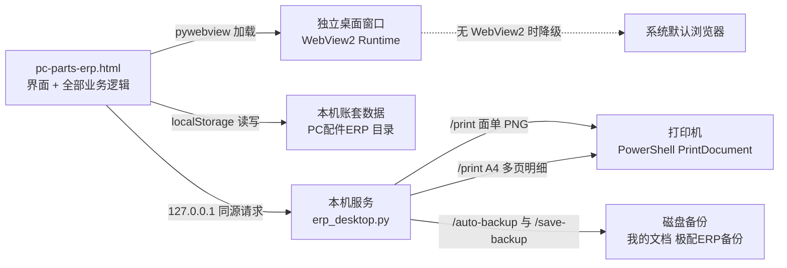

# 🧾➡️📦 极配 ERP · 电脑配件进销存 · 单机桌面账套

> 把**采购、销售、库存、物流、退货、往来对账和快递面单**装进一个 EXE，
> 双击打开就是独立窗口，按真实单据流程从进货一路走到收款与打印。
> 数据只存在**你自己的电脑里**，不联网、不注册、不上传，也不依赖任何数据库或运行库。

[](https://www.microsoft.com)
[](./LICENSE)
[](./CHANGELOG.md)
[]()

[](https://github.com/ChenxiGK/-ERP/actions/workflows/ci.yml)
[](https://github.com/ChenxiGK/-ERP/releases/latest)
[]()

---

## ✨ 这是什么

极配 ERP 是给电脑配件**批发零售 / 装机工作室 / 一两台电脑的小商行**用的单机账套。
它不是需要部署的 Web 系统，而是一个 13 MB 左右的 Windows 程序：界面、打印服务、自动备份全在里面，
打开后从采购下单、收货建档、销售开单、绑物流、打面单，到退货冲减与收付款对账，一条链路走完：

- 采购收货后商品自动建档，多张销售单可合并采购，但每张单各自留痕；
- 销售单的售价 / 运费 / 数量 / 客户随时可改，库存与毛利跟着重算；
- 面单按毫米尺寸**直连打印机**，不弹浏览器打印预览，纸型选一次就记住；
- 数据改动自动写磁盘备份，误删、导错、恢复错了都能撤回。

典型用途：**电脑配件进出货记账 / 装机单与配件库存核对 / 快递面单与对货码管理 / 月度销售明细打印 / 应收应付对账**。

---

## 🚀 核心特性

- **一个 EXE 全包**：`pywebview` + 系统自带 WebView2 提供独立窗口，打印与备份服务随窗口启停，不用装 Python / .NET / 数据库。
- **按真实单据流程做**：采购收货自动建档、合并采购保留各销售单、运费由商家承担并从毛利扣除、退货按原单所属月份冲减销售额 / 毛利 / 应收。
- **面单直连打印（关键特性）**：前端按 203 dpi 生成面单 PNG，经本机服务交给 PowerShell `PrintDocument` 直接送打印机，
  **完全跳过浏览器打印预览**；Code128B 条码、对货码、收件地址都在面单上。
- **纸型记忆**：100×180 / 100×150 / 76×130 mm 三种纸型，换一次就记住，还能跟随打印机默认纸张。
- **退货物流单独出单**：不关联销售单，只填快递单号、对货码、地址即可生成黑底「退货物流 · RETURN」面单。
- **物流台账**：承运商自动识别、单号可修改、轨迹登记与查询、收件信息维护、运单按最新时间倒序。
- **销售统计可穿透**：按月汇总与环比，点某个日期直接下钻到当天每笔订单，A4 明细按
  `序号 / 商品名称 / 品牌 / 规格 / 数量 / 进货价 / 销售价 / 利润` 打印，多页自动续打。
- **往来对账与销售退货**：应收应付 KPI、按单位 / 按单据核对、逐笔收付款（分批 / 撤销 / 清零重登）；
  退货按行限制剩余可退数量，自动回库并写流水，作废 / 删除反向扣回。
- **数据安全兜底**：5 分钟节流的磁盘自动备份滚动保留 30 份，一键恢复；清空 / 导入 / 恢复演示数据前留快照，可撤销上一次操作。
- **效率工具**：商品 CSV 模板 / 导入 / 导出、自定义采购快捷商品、六个列表的关键字搜索与状态筛选、库存售罄自动隐藏与一键清理。
- **兼容性自适应**：窗口按屏幕可用区域调整大小，端口 8765→8776 自动避让，缺少 WebView2 时降级到系统默认浏览器。

---

## 🧭 工作原理



> 业务界面是一个单文件 HTML（原生 HTML/CSS/JS，无框架、无构建、无 CDN）；桌面壳只负责开窗口，
> 并由只监听 `127.0.0.1` 的本机 HTTP 服务处理面单直连打印、A4 多页打印、自动备份与 CSV 落盘。
> 同源请求用相对路径，端口避让后打印与备份依然可用；服务不接受外部访问，文件名走白名单校验。

---

## 🖼️ 界面预览


| 采购管理 | 销售管理 |
| --- | --- |
|  |  |

| 往来对账 | 销售退货 |
| --- | --- |
|  |  |

| 数据管理 | 面单样例 |
| --- | --- |
|  |  |

> 截图中的客户、供应商、电话、地址均为虚构演示数据。

---

## 🏁 快速开始

### 1. 拿到程序

到 [Releases](https://github.com/ChenxiGK/-ERP/releases/latest) 下载 `JipeiERP-v2.2.0-Windows-EXE.zip`，
解压后双击 `极配ERP.exe`。无需安装、无需联网、无需账号；首次弹出「未知发布者」时点「更多信息」→「仍要运行」。

> 源码仓库**不含 EXE**（二进制只走 Releases），也不含任何真实业务数据。

### 2. 开第一张单

| 想做的事 | 去哪里 |
| --- | --- |
| 建商品 / 供应商 / 客户档案 | 商品管理、供应商、客户 |
| 进货、收货入库 | 采购管理 → 新建采购单 → 收货（自动建档） |
| 卖货、改价改数量 | 销售管理 → 新建销售单 → 发货 |
| 绑单号、查轨迹、设对货码 | 物流中心 |
| 看本月赚了多少、点日期看当天 | 销售统计 |
| 收付款、退货、备份 | 往来对账、销售退货、数据管理 |

### 3. 打印面单

销售管理 → 某张单的「面单」→ 选打印机 →「直接打印」。三种纸型在弹窗里可切换，选过即成为默认值：

| 纸型 | 用途 |
| --- | --- |
| **100 × 180 mm** | 电子面单，最常用（默认） |
| **100 × 150 mm** | 京东 / 菜鸟旧版 |
| **76 × 130 mm** | 小面单 |

> 想统一设定或恢复出厂，到【数据管理】→「面单打印默认设置」；设置会跟着 JSON 备份一起导出。
> 单独的退货面单在【物流中心】→「单独打印面单（退货物流）」。

### 4. 备份与换电脑

【数据管理】→「导出备份（JSON）」存到其它磁盘，换机后「导入备份」即可。
平时不用管：任何数据改动都会自动写一份到 `我的文档\极配ERP备份\自动备份`，5 分钟内不重复、最多留 30 份。

面向使用者的完整图文说明见 [使用说明.txt](使用说明.txt)。

---

## ⚙️ 配置说明

账套数据与偏好保存在本机 `localStorage`（桌面版为 `%LOCALAPPDATA%\PC配件ERP\WebView2`），主要键：

| 键 / 位置 | 含义 | 默认 |
| --- | --- | --- |
| `pcparts_erp_db_v1` | 全部账套数据（单据、商品、流水、设置） | 空库 |
| `pcparts_erp_db_v1.prev` | 危险操作前的数据快照，供「撤销上一次操作」 | 无 |
| `pcparts_erp_db_v1.printer` | 上次选中的打印机名 | 系统默认打印机 |
| `DB.settings.label.size` | 面单默认纸型 | `100x180` |
| `DB.settings.label.auto` | 跟随打印机默认纸张 | `false` |
| `DB.settings.returnLabel` | 退货面单上次填写的单号 / 承运商 / 收件信息 | 空 |
| `DB.settings.puQuickCustom` | 采购自定义快捷商品（名称 / 分类 / 品牌 / 规格 / 进价） | 空数组 |
| 服务端口 | 本机 HTTP 服务，占用时自动往后找 | `8765` ~ `8776` |
| 备份目录 | 自动备份 / 手动导出 / CSV 导出 | `我的文档\极配ERP备份\` |

> 浏览器版（直接双击 `pc-parts-erp.html`）数据存在浏览器自己的 localStorage，与桌面版互相独立；
> 也没有「面单直连打印」和「磁盘自动备份」——这两项依赖本机服务，其余功能一致。

---

## ❓ 常见问题

**Q：双击提示「未知发布者」？**
A：EXE 未做数字签名（代码签名证书需付费），点「更多信息」→「仍要运行」即可，属正常现象。

**Q：双击没反应 / 没有窗口？**
A：先看任务栏，可能已有一个实例在运行（不会重复开）；或端口被占用，程序会自动换端口。
仍不行时到任务管理器结束「极配ERP」后重试。

**Q：缺少 WebView2 怎么办？**
A：程序会自动退回系统默认浏览器，并弹一个命令行窗口维持服务（使用期间别关它）。
装一次微软 WebView2 Runtime 后再打开即可恢复独立窗口。

**Q：支持 Windows 7 / 8 / XP / 32 位吗？**
A：不支持。这些系统缺少程序依赖的浏览器内核，且微软已停止更新。

**Q：打印提示「打印机不可用」或面单尺寸不对？**
A：在面单弹窗里重新选一次打印机，确认在线且驱动正常；纸型到【数据管理】→「面单打印默认设置」统一设定。

**Q：能多台电脑 / 多个人同时用同一份数据吗？**
A：不能。设计上是单机账套，多端并发需要服务端架构，本项目刻意不做。

**Q：升级会丢数据吗？**
A：不会，直接替换 EXE 即可，数据目录不受影响；从 v2.1 升级会自动补齐新字段，老单据不会集体显示「未收款」。

---

## 🛠️ 从源码构建

```bash
# 1. 安装依赖（Python 3.10+ / Windows）
pip install -r requirements.txt

# 2. 源码运行桌面版
python erp_desktop.py

# 3. 只想看界面：直接双击 pc-parts-erp.html（浏览器版，无需 Python）

# 4. 打包为单文件 EXE
python -m PyInstaller --noconfirm 极配ERP.spec

# 5. 跑回归测试
tests\run-tests.bat
node tools/check-readme-images.js
```

产物为 `dist/极配ERP.exe`（约 13 MB，`--onefile --windowed`、关闭 UPX）。
spec 会把 `pc-parts-erp.html`、`app.ico` 与 `version_info.txt`（`2.2.0.0`）一并打进去，
启动时由 `erp_desktop.py` 注入桌面版专用脚本并启动本机服务。

---

## 🧩 实现要点

- 业务界面是**单文件 HTML + 原生 JS**：`LS_KEY = pcparts_erp_db_v1`，`normalizeDB()` 在导入旧备份时自动补齐字段，
  避免清空数据丢 `settings`、旧备份缺字段导致物流页崩溃。
- 桌面壳在 8765→8776 间 `pick_port()` 自动避让，检测到自身已在运行则复用；前端 `AGENT_URL` 在 http(s) 下用相对路径，
  因此端口变化不影响打印与备份。
- 面单用 `labelHTML()` / `labelCanvas()` 按 203 dpi 生成 PNG，`@page size` 控制纸型，
  本机 `/print` 交给 PowerShell `System.Drawing.Printing.PrintDocument`，`HasMorePages` 支持 A4 明细多页续打。
- 浏览器打印兜底走隐藏 iframe 的 `srcdoc`（`blob:` 在 `file://` 下跨源会让 `print()` 失效）。
- `/auto-backup` 5 分钟节流、滚动保留 30 份；`/save-backup` 与 CSV 导出做文件名白名单和路径穿越防护。
- 清空 / 导入 / 恢复演示数据前写 `SNAP_KEY` 快照，「撤销上一次操作」直接整体回滚。
- 测试用 Node `vm` 加载前端脚本 + DOM / localStorage 桩做断言，Python 侧起真实 HTTP 服务并把备份隔离到临时目录；
  CI 在 Windows 上跑 UTF-8 输出与 PyInstaller 完整性检查。

---

## 📁 目录结构

```
pc-parts-erp.html            界面 + 全部业务逻辑（单文件，无框架无构建）
erp_desktop.py               桌面壳：WebView2 窗口 + 本机服务（打印 / 备份 / 导出）
极配ERP.spec                 PyInstaller 打包配置
version_info.txt             EXE 版本资源（2.2.0.0）
app.ico / requirements.txt   图标 / Python 依赖
使用说明.txt                 面向使用者的完整说明
CHANGELOG.md                 版本记录
LICENSE                      MIT 许可证（英文原文，具法律效力）
授权说明.md                  MIT 的中文通俗解释（仅供阅读）
RELEASE_NOTES_v2.2.0.md      本版更新与 SHA-256 校验
docs/
  screenshots/               7 张界面截图（演示数据）
  label-sample-100x180mm.png 面单样式（含条码与对货码）
tests/                       回归测试（Node.js + Python + Windows 批处理）
tools/
  check-readme-images.js     README 图片路径 / 文件名自检
  gen_icon.py                图标生成脚本（纯标准库）
.github/                     Issue / PR 模板与 CI
legacy/                      旧版浏览器启动器与独立打印服务（已停用，仅存档）
```

---

## 📝 已知限制

- 单机账套，不支持多用户并发、多门店实时同步、手机端；没有账号体系、遥测或云同步。
- 仅支持 Windows 10 / 11（64 位）；Windows 7 / 8 / XP 与 32 位系统不可用。
- 浏览器版没有面单直连打印与磁盘自动备份（依赖本机服务）。
- EXE 未做数字签名，首次运行会有「未知发布者」提示。
- 不含发票、税务申报、多币种与工资模块；账务结果请自行核对并定期导出 JSON 备份。

---

## 📜 许可证

本项目以 **MIT License** 开源，详见 [LICENSE](./LICENSE)。中文通俗解释见 [授权说明.md](授权说明.md)（法律效力以英文原文为准）。

> 打包产物内含的 Python 运行时与 pywebview 等第三方库遵循各自的许可证；WebView2 Runtime 由微软提供，
> 不随本仓库分发。欢迎按 [CONTRIBUTING.md](CONTRIBUTING.md) 提交 Issue / PR，安全问题请按 [SECURITY.md](SECURITY.md) 私下报告。
